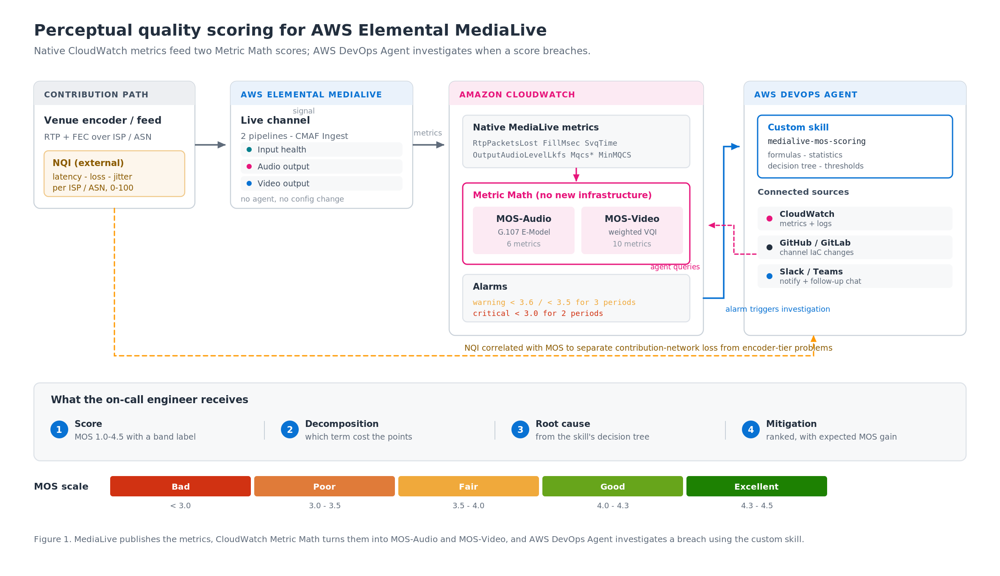
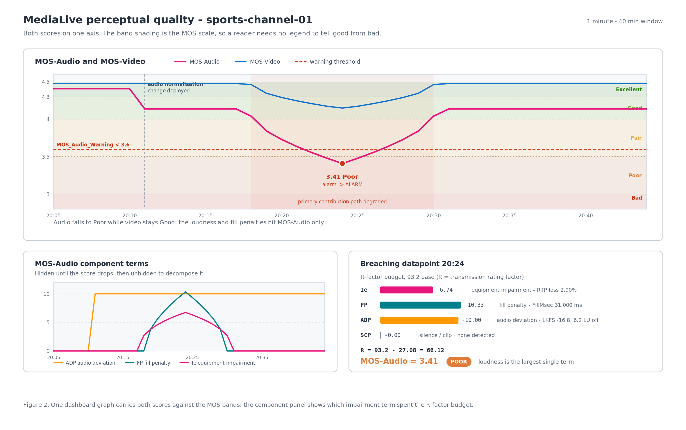
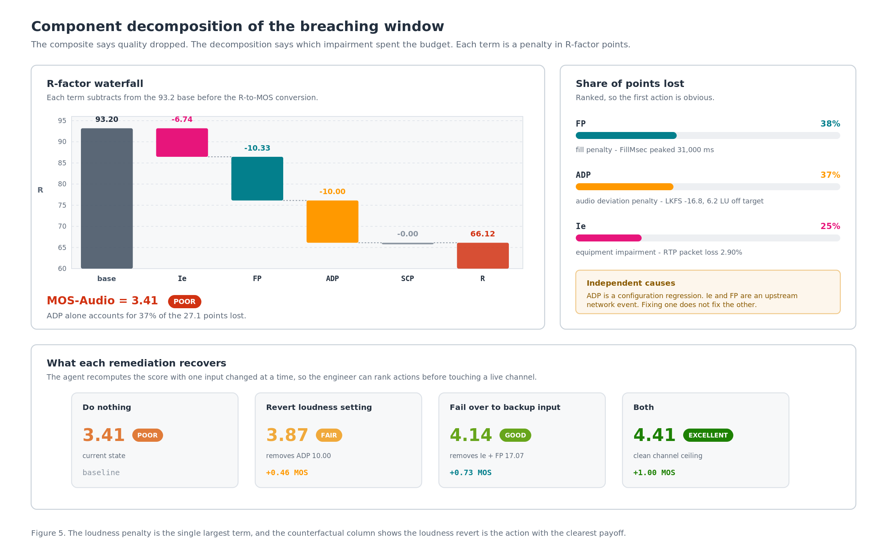

# MediaLive MOS Scoring

Derive **MOS-Audio** and **MOS-Video** perceptual quality scores for AWS Elemental MediaLive channels from native Amazon CloudWatch metrics, using ITU-T E-Model principles adapted for broadcast and live streaming.

No agent on the encoder. No Lambda function. No change to your MediaLive channel configuration. Both scores are CloudWatch Metric Math expressions over metrics your channels already publish.

This repository also packages the scoring logic as a custom skill for [AWS DevOps Agent](https://aws.amazon.com/devops-agent/), so an engineer can ask "why did audio quality drop?" in plain language and get a scored answer with a ranked root cause.

> **Companion blog post:** *Score live stream quality the way viewers perceive it with AWS Elemental MediaLive and AWS DevOps Agent* on the AWS for M&E Blog. The post covers the problem and the benefits; this README carries the full derivation.



---

## Contents

- [Why perceptual scoring](#why-perceptual-scoring)
- [The MOS scale](#the-mos-scale)
- [MOS-Audio: the model](#mos-audio-the-model)
- [MOS-Video: the model](#mos-video-the-model)
- [Deploy: CloudWatch Metric Math](#deploy-cloudwatch-metric-math)
- [Deploy: CloudWatch alarms](#deploy-cloudwatch-alarms)
- [Deploy: the DevOps Agent skill](#deploy-the-devops-agent-skill)
- [Diagnostics decision trees](#diagnostics-decision-trees)
- [Graceful degradation](#graceful-degradation)
- [Calibration and validity](#calibration-and-validity)
- [Cost](#cost)
- [Repository layout](#repository-layout)
- [Glossary](#glossary)
- [References](#references)

---

## Why perceptual scoring

MediaLive publishes dozens of CloudWatch metrics describing the mechanics of a channel. Each is precise, and none is perceptual. An engineer reading eight graphs still has to translate counters into viewer experience under time pressure.

Single-metric alarms also miss stacked impairments. Consider one 60-second window with 0.9% packet loss, 18 seconds of fill frames, and loudness 4.5 LU above target. Scored individually, each impairment is Good or better. Together they are not:

| Impairment present | Ie | FP | ADP | R | MOS-Audio |
|---|---|---|---|---|---|
| Packet loss only | 2.48 | 0.00 | 0.00 | 90.72 | 4.36 (Excellent) |
| Fill only | 0.00 | 6.00 | 0.00 | 87.20 | 4.26 (Good) |
| Loudness only | 0.00 | 0.00 | 7.50 | 85.70 | 4.22 (Good) |
| **All three together** | 2.48 | 6.00 | 7.50 | **77.22** | **3.91 (Fair)** |

A composite score catches this class of problem because impairments accumulate in the model the way they accumulate in the viewer's ear and eye.

**The tradeoff:** a composite tells you quality dropped, not which component dropped. Every score in this repository is therefore paired with a decomposition back into its contributing terms, and with a [diagnostics decision tree](#diagnostics-decision-trees).

## The MOS scale

Both scores use the standard 1.0–4.5 Mean Opinion Score scale.

| MOS | Perception | Action |
|---|---|---|
| 4.3 – 4.5 | Excellent | None |
| 4.0 – 4.3 | Good | Monitor |
| 3.5 – 4.0 | Fair | Investigate |
| 3.0 – 3.5 | Poor | Act immediately |
| Below 3.0 | Bad | Escalate |

The ceiling is 4.5, not 5.0. The G.107 conversion maps a perfect path (R = 100) to exactly 4.5, and a clean path with default E-Model parameters (R = 93.2) to 4.41. Using the same ceiling for both scores means a MOS-Audio of 4.2 and a MOS-Video of 4.2 describe comparable experiences, so they can share one graph axis without a caveat.

## MOS-Audio: the model

MOS-Audio adapts the [ITU-T G.107 E-Model](https://www.itu.int/rec/T-REC-G.107) for broadcast AAC audio. The E-Model computes a transmission rating factor **R** by subtracting impairment penalties from a base of 93.2, then maps R to a MOS value.

### Notation

Each penalty is in R-factor points, where 0 means no impairment. Larger is worse.

| Term | Expands to | What it penalizes | Range | Driven by |
|---|---|---|---|---|
| `PLR` | Packet Loss Rate | lost packets as a percentage of those sent | 0–100% | `RtpPacketsLost`, `RtpPacketsReceived` |
| `Ie` | Equipment Impairment factor | perceptual damage from that packet loss | 0–30 | `PLR` |
| `Ie_max` | maximum equipment impairment | worst-case `Ie` for the codec | 30 for AAC @ 128 kbps | constant |
| `Bpl` | packet-loss robustness factor | how well the codec tolerates loss | 10 for AAC @ 128 kbps | constant |
| `FP` | Fill Penalty | fill frames substituted during input failure | 0–20 | `FillMsec` |
| `ADP` | Audio Deviation Penalty | program loudness off the −23 LKFS target | 0–10 | `OutputAudioLevelLkfs` |
| `SCP` | Silence/Clip Penalty | digital silence or clipping | 0, 5, or 10 | `OutputAudioLevelDbfs` |
| `R` | transmission Rating factor | what survives after all penalties | 0–100 | 93.2 − penalties |

Penalty weights reflect how much damage each failure mode can do. Fill frames reach 20 points because sustained fill means the viewer sees nothing real; loudness caps at 10 because badly normalized audio is still intelligible audio.

### Step 1 — Packet loss rate

```
PLR = IF(RtpPacketsLost + RtpPacketsReceived > 0,
         RtpPacketsLost / (RtpPacketsLost + RtpPacketsReceived) * 100,
         0)
```

For non-RTP inputs (HLS pull, plain UDP), `RtpPackets*` metrics are absent; fall back to `ChannelInputErrorSeconds / window_seconds * 100`.

### Step 2 — Equipment impairment factor

```
Ie = (Ie_max * PLR) / (PLR + Bpl)
   = (30 * PLR) / (PLR + 10)
```

The curve is deliberately non-linear — the first fraction of a percent of loss costs far more perceived quality than the tenth:

| PLR | 0.5% | 5% | 50% |
|---|---|---|---|
| `Ie` | 1.43 | 10.00 | 25.00 |

It approaches the 30-point ceiling asymptotically and never reaches it.

### Step 3 — Fill penalty

```
FP = MIN(FillMsec_max / 60000, 1.0) * 20
```

`FillMsec` counts milliseconds during which MediaLive substituted fill content because the input failed. A full minute of fill in the window applies the maximum 20-point penalty.

### Step 4 — Loudness deviation penalty

```
ADP = MIN(ABS(LKFS_avg - (-23)) / 6.0, 1.0) * 10
```

[EBU R 128](https://tech.ebu.ch/publications/r128) sets the program loudness target at −23 LKFS. A deviation of 6 LU or more applies the full 10-point penalty.

This term is what makes the result a *broadcast* quality score rather than a packet-health score. Audio that arrives intact but 8 LU hot is still a bad listening experience.

### Step 5 — Silence and clip penalty

```
SCP = IF(dBFS_min <= -60, 5, 0) + IF(dBFS_max >= -1, 5, 0)
```

dBFS is peak level, as distinct from the LKFS loudness average in Step 4. A channel can average −23 LKFS while one side is silent and the other clipping. Each condition costs 5 points, so a stream doing both costs 10.

### Step 6 — Rating factor and MOS

```
R = MAX(0, MIN(100, 93.2 - Ie - FP - ADP - SCP))
MOS_Audio = MAX(1.0, MIN(4.5, 1 + 0.035*R + R*(R-60)*(100-R)*7e-6))
```

The last line is the standard G.107 R-to-MOS conversion. It is an S-curve, not a straight line, which has a practical consequence: the same one-point penalty costs different amounts of MOS depending on where the channel already sits.

| R | 0 | 50 | 60 | 70 | 80 | 93.2 | 100 |
|---|---|---|---|---|---|---|---|
| MOS | 1.00 | 2.58 | 3.10 | 3.60 | 4.02 | 4.41 | 4.50 |

The curve is flattest at the extremes and steepest near R = 54, where one R point costs about 0.053 MOS. Near R = 95 the same point costs only 0.017. A channel already in trouble degrades fastest.

## MOS-Video: the model

Video has no equivalent of the E-Model with published coefficients, so MOS-Video uses a weighted composite in the spirit of [VMAF](https://github.com/Netflix/vmaf).

**Note the sign convention flips here.** Audio terms are penalties where larger is worse. Video components are scores from 0 to 1, where 1.0 is unimpaired.

| Component | Expands to | Weight | What it measures | MediaLive metrics |
|---|---|---|---|---|
| `FDS` | Frame Drop Score | 35% | frames reaching the viewer | `DroppedFrames`, `MqcsVideoFrameDrops` |
| `FFS` | Freeze Frame Score | 25% | picture advancing rather than frozen | `MqcsFreezeFrameDetected`, `FillMsec` |
| `EQS` | Encoder Quality Score | 20% | encoder keeping up without softening | `SvqTime`, `MqcsSvq` |
| `CIS` | Content Integrity Score | 15% | real content, not black or filler | `MqcsBlackFrameDetected`, `MqcsFillFrameInsertion`, `MqcsContinuityCounterErrors` |
| `MNS` | MQCS Normalized Score | 5% | MediaLive's own composite, as cross-check | `MinMQCS` |
| `VQI` | Video Quality Index | — | the five scores combined, 0–1 | all of the above |

The weights follow the order in which viewers notice problems. Dropped frames and freezes are immediately obvious. Encoder softness during a high-motion scene is noticeable but tolerable. A single black frame is a glitch. `MinMQCS` gets the smallest weight because its components are already represented individually.

### Component calculations

`FPS` is the channel's output frame rate.

```
drop_rate = DroppedFrames_sum / (FPS * window_seconds)
FDS = 1 - MIN(1, drop_rate*0.5 + ((100 - MqcsVideoFrameDrops_min)/100)*0.5)

FFS = (MqcsFreezeFrameDetected_min/100)*0.7
    + (1 - MIN(1, FillMsec_max/30000))*0.3

EQS = (1 - MIN(1, SvqTime_max/100))*0.5 + (MqcsSvq_min/100)*0.5

CIS = (MqcsBlackFrameDetected_min/100)*0.35
    + (MqcsFillFrameInsertion_min/100)*0.35
    + (MqcsContinuityCounterErrors_min/100)*0.30

MNS = MinMQCS_min / 100
```

### Composite and MOS

```
VQI = FDS*0.35 + FFS*0.25 + EQS*0.20 + CIS*0.15 + MNS*0.05
MOS_Video = MAX(1.0, MIN(4.5, 1.0 + POW(VQI, 0.9) * 3.5))
```

The `POW(VQI, 0.9)` exponent applies a mild concave curve, so a channel degrading from perfect to very slightly impaired loses more score than a linear mapping would give it. This matches how viewers report quality: the first visible artifact draws far more complaints than the fifth.

## Deploy: CloudWatch Metric Math

### MOS-Audio

Add these metrics to a CloudWatch graph for your channel at a 60-second period, with the statistic shown:

```
m1 = RtpPacketsLost          (Sum)
m2 = RtpPacketsReceived      (Sum)
m5 = OutputAudioLevelDbfs    (Minimum)
m6 = OutputAudioLevelDbfs    (Maximum)
m7 = OutputAudioLevelLkfs    (Average)
m9 = FillMsec                (Maximum)
```

Then add these expressions:

```
PLR   = IF(m1+m2 > 0, m1/(m1+m2)*100, 0)
Ie    = IF(PLR == 0, 0, (30 * PLR) / (PLR + 10))
FP    = MIN(m9/60000, 1) * 20
ADP   = MIN(ABS(m7 - (-23)) / 6, 1) * 10
SCP   = IF(m5 <= -60, 5, 0) + IF(m6 >= -1, 5, 0)
R     = MAX(0, MIN(100, 93.2 - Ie - FP - ADP - SCP))
MOS_A = MAX(1, MIN(4.5, 1 + 0.035*R + R*(R-60)*(100-R)*7e-6))
```

**Display only `MOS_A` and keep the intermediate expressions hidden.** When the score drops, unhide `Ie`, `FP`, `ADP`, and `SCP` to see which term caused it. This is the fastest decomposition available and costs nothing to keep ready.



A ready-made dashboard body is in [`dashboard/dashboard-body.json`](dashboard/dashboard-body.json). Replace `CHANNEL_ID` and `REGION`, then:

```bash
aws cloudwatch put-dashboard \
  --dashboard-name MediaLive-MOS \
  --dashboard-body file://dashboard/dashboard-body.json
```

### MOS-Video

```
m8  = DroppedFrames                  (Sum)
m9  = FillMsec                       (Maximum)
m10 = SvqTime                        (Maximum)
m11 = MinMQCS                        (Minimum)
m12 = MqcsVideoFrameDrops            (Minimum)
m13 = MqcsFreezeFrameDetected        (Minimum)
m14 = MqcsSvq                        (Minimum)
m15 = MqcsBlackFrameDetected         (Minimum)
m16 = MqcsFillFrameInsertion         (Minimum)
m17 = MqcsContinuityCounterErrors    (Minimum)
```

```
drop_rate   = IF(m8 > 0, m8/(30*60), 0)
vfd_norm    = IF(ISPRESENT(m12), (100-m12)/100, 0)
FDS         = 1 - MIN(1, drop_rate*0.5 + vfd_norm*0.5)

freeze_norm = IF(ISPRESENT(m13), m13/100, 1)
fill_pen    = MIN(1, m9/30000)
FFS         = freeze_norm*0.7 + (1-fill_pen)*0.3

svq_norm    = IF(ISPRESENT(m14), m14/100, 1)
EQS         = (1 - MIN(1, m10/100))*0.5 + svq_norm*0.5

black_norm  = IF(ISPRESENT(m15), m15/100, 1)
fillfr_norm = IF(ISPRESENT(m16), m16/100, 1)
cc_norm     = IF(ISPRESENT(m17), m17/100, 1)
CIS         = black_norm*0.35 + fillfr_norm*0.35 + cc_norm*0.30

MNS         = IF(ISPRESENT(m11), m11/100, 1)
VQI         = FDS*0.35 + FFS*0.25 + EQS*0.20 + CIS*0.15 + MNS*0.05
MOS_V       = MAX(1.0, MIN(4.5, 1.0 + POW(VQI, 0.9) * 3.5))
```

> **Two things to adjust before use.**
>
> 1. The `drop_rate` denominator assumes **30 fps** over a 60-second period. Change the `30` in `m8/(30*60)` to match your channel's output frame rate, or the frame-continuity component will misreport.
> 2. The `ISPRESENT` guards are what make this expression safe on channels without a CMAF Ingest output group. Keep them.

## Deploy: CloudWatch alarms

```yaml
MOS_Audio_Warning:
  Expression: MOS_A
  Threshold: "< 3.6"
  Period: 60
  EvaluationPeriods: 3
  TreatMissingData: notBreaching
  AlarmDescription: "MediaLive audio MOS below Fair - investigate input health and loudness"

MOS_Audio_Critical:
  Expression: MOS_A
  Threshold: "< 3.0"
  Period: 60
  EvaluationPeriods: 2
  TreatMissingData: notBreaching
  AlarmDescription: "MediaLive audio MOS Poor/Bad - listener impact likely, check RTP loss and FillMsec"

MOS_Video_Warning:
  Expression: MOS_V
  Threshold: "< 3.5"
  Period: 60
  EvaluationPeriods: 3
  TreatMissingData: notBreaching
  AlarmDescription: "MediaLive video MOS below Fair - check DroppedFrames and SvqTime"

MOS_Video_Critical:
  Expression: MOS_V
  Threshold: "< 3.0"
  Period: 60
  EvaluationPeriods: 2
  TreatMissingData: notBreaching
  AlarmDescription: "MediaLive video MOS Poor/Bad - viewer impact likely, escalate to input failover"
```

Warning alarms require three consecutive breaching periods; critical alarms require two. A single 60-second dip during a scene change or ad insertion is not worth a page, but three minutes of degraded audio during a live event is. Set `TreatMissingData: notBreaching` so an idle channel between events does not alarm.

## Deploy: the DevOps Agent skill

### Prerequisites

- An AWS DevOps Agent Agent Space. DevOps Agent is available in US East (N. Virginia), US West (Oregon), Europe (Frankfurt), Europe (Ireland), Asia Pacific (Sydney), and Asia Pacific (Tokyo).
- CloudWatch connected to the Agent Space as an observability source, with read access to the MediaLive namespace.
- *Optional:* Slack or Microsoft Teams connected, so the agent reports in the channel your team already watches.
- *Optional:* GitHub or GitLab connected, so the agent can correlate a quality regression with a channel configuration change in infrastructure as code.

### Install

A DevOps Agent skill is a set of instructions, not code. `medialive-mos-scoring` contains the metric table with required statistics, both formulas, the MOS scale, the diagnostics decision trees, the alarm templates, and the graceful-degradation rules.

```bash
cd skill
zip -r ../medialive-mos-scoring-skill.zip .
```

Then upload `medialive-mos-scoring-skill.zip` in your Agent Space skills configuration and confirm it shows as enabled. See [AWS DevOps Agent skills](https://docs.aws.amazon.com/devopsagent/latest/userguide/about-aws-devops-agent-devops-agent-skills.html) for the general mechanics.

### Trigger phrases

The agent selects the skill by semantic match, so nobody needs to name it. These all route correctly:

- "MediaLive audio quality" / "video quality"
- "MOS score" / "Mean Opinion Score"
- "OutputAudioLevelLkfs" / "OutputAudioLevelDbfs"
- "DroppedFrames" / "FillMsec" / "SvqTime"
- "MQCS metrics" / "MinMQCS"
- "EBU R 128" / "LKFS" / "broadcast loudness compliance"
- "live streaming quality degradation"

### What the skill changes

Without the skill, DevOps Agent can read MediaLive metrics and describe them. It has no reason to prefer `Max` over `Average` for `FillMsec`, no knowledge that −23 LKFS is the compliance target, and no model for combining the signals.

With the skill, the agent knows the statistic for each metric, the formula to apply, and the tree to walk when a score comes back low. Statistics matter more than they look: `FillMsec` averaged across a window hides the fill burst entirely.

| Metric | Statistic | Why |
|---|---|---|
| `FillMsec` | `Max` | an average hides bursts |
| `RtpPacketsLost` / `Received` | `Sum` | a rate needs a window total |
| `OutputAudioLevelLkfs` | `Average` | program loudness is an average by definition |
| `OutputAudioLevelDbfs` | `Min` + `Max` | silence and clipping are opposite extremes |
| `Mqcs*`, `MinMQCS` | `Min` | worst case in the window |
| `DroppedFrames` | `Sum` | a rate needs a window total |
| `SvqTime` | `Max` | peak encoder strain |

## Diagnostics decision trees

The skill walks these trees to decompose a low score into a cause. FEC below is forward error correction, which rebuilds lost RTP packets from redundant data.



### Audio

```
MOS-Audio < 3.6?
├── RtpPacketsLost > 0?
│   ├── YES -> Is FEC functioning? (FecRowPacketsReceived > 0)
│   │          YES: upstream network degraded -> engage the upstream team
│   │          NO:  FEC absent or misconfigured -> check RTP input FEC settings
│   └── NO  -> FillMsec > 5000 ms?
│              YES: input failing -> check InputLossSeconds, PrimaryInputActive
│              NO:  LKFS deviation > 3 LU from -23?
│                   YES: loudness normalization problem
│                   NO:  silence or clipping on dBFS -> check audio routing
```

### Video

```
MOS-Video < 3.5?
├── DroppedFrames > 0?
│   ├── YES -> SvqTime > 20%?
│   │          YES: encoder overloaded -> reduce encode complexity
│   │               or upgrade channel class
│   │          NO:  check NetworkIn for input starvation
│   │               -> investigate upstream bandwidth
│   └── NO  -> FillMsec > 5000 ms?
│              YES: input failing -> check ChannelInputErrorSeconds,
│                   InputLossSeconds
│              NO:  MQCS sub-scores < 80?
│                   MqcsBlackFrameDetected:      black frame in source feed
│                   MqcsFreezeFrameDetected:     frozen frame in source feed
│                   MqcsContinuityCounterErrors: MPEG-TS stream corruption
```

## Graceful degradation

The `Mqcs*` metrics come from the MediaLive Media Quality Confidence Score feature, which requires a CMAF Ingest output group. Not every channel has one, and the model degrades rather than failing.

| Scenario | Missing metrics | Behavior |
|---|---|---|
| Non-RTP input (HLS pull, UDP) | `RtpPackets*`, `Fec*` | Baseline `PLR` of 0; fall back to `ChannelInputErrorSeconds` |
| No CMAF Ingest output group | All `Mqcs*` | MQCS terms default to 1.0; core video metrics stay active |
| Single-pipeline channel | One pipeline set | Score the available pipeline; take the minimum across both when redundant |
| Audio-only channel | All video metrics | Compute MOS-Audio only; suppress MOS-Video |

**Defaulting absent MQCS terms to 1.0 is optimistic by design.** A channel without CMAF Ingest still gets a usable MOS-Video from `DroppedFrames`, `FillMsec`, and `SvqTime`, but it cannot detect source-side black frames or continuity errors. Treat scores from such channels as a floor on impairment, not a complete picture.

## Calibration and validity

**These are engineering estimates, not subjective test results.** A true MOS comes from a human panel under [ITU-T P.800](https://www.itu.int/rec/T-REC-P.800) conditions. Two specific caveats:

1. The E-Model coefficients (`Ie_max = 30`, `Bpl = 10`) are published for narrowband voice codecs and adapted here for broadcast AAC.
2. The MOS-Video weights (35/25/20/15/5) come from operational experience, not from regression against a scored dataset.

Treat absolute values as relative indicators and calibrate before trusting a threshold in production:

1. Deploy the expressions on a non-production channel.
2. Run several scheduled events through them.
3. Compare the scores against what your quality control operators report.
4. Adjust weights where the score and your operators disagree.
5. Only then put the alarms in front of on-call.

The value is a consistent, auditable composite that trends with viewer experience — not the second decimal place.

## Cost

CloudWatch Metric Math expressions are billed per **metric referenced**, not per expression. MOS-Audio references 6 metrics and MOS-Video references 10, so a fully instrumented channel adds **16 CloudWatch metrics**. There is no agent, no Lambda function, and no data egress in this solution.

## Repository layout

```
.
├── README.md                     this file
├── CONTRIBUTING.md
├── CODE_OF_CONDUCT.md
├── LICENSE                       MIT-0
├── skill/
│   └── SKILL.md                  the DevOps Agent skill: metrics, formulas,
│                                 decision trees, thresholds, reporting rules
├── metric-math/
│   ├── mos-audio.txt             paste-ready CloudWatch expressions
│   └── mos-video.txt
├── alarms/
│   └── mos-alarms.yaml           CloudFormation template for the audio alarms
├── dashboard/
│   └── dashboard-body.json       dashboard: both scores + component terms
├── reference/
│   ├── mos_model.py              authoritative implementation of both models
│   └── verify.py                 regression checks on every published number
└── docs/
    ├── architecture.png
    ├── dashboard.png
    ├── decomposition.png
    └── root-cause.png
```

`reference/mos_model.py` is the authoritative implementation. Every number in this README and in the companion blog post is computed from it rather than typed by hand; `reference/verify.py` re-derives them and fails on drift.

```bash
cd reference
python3 verify.py
```

## Glossary

**MOS-Audio penalties** — R-factor points, larger is worse.

| Term | Expands to |
|---|---|
| `PLR` | Packet Loss Rate |
| `Ie` | Equipment Impairment factor |
| `Ie_max` | maximum equipment impairment (30 for AAC @ 128 kbps) |
| `Bpl` | packet-loss robustness factor (10 for AAC @ 128 kbps) |
| `FP` | Fill Penalty |
| `ADP` | Audio Deviation Penalty |
| `SCP` | Silence/Clip Penalty |
| `R` | transmission Rating factor |

**MOS-Video components** — scores from 0 to 1, larger is better.

| Term | Expands to | Weight |
|---|---|---|
| `FDS` | Frame Drop Score | 35% |
| `FFS` | Freeze Frame Score | 25% |
| `EQS` | Encoder Quality Score | 20% |
| `CIS` | Content Integrity Score | 15% |
| `MNS` | MQCS Normalized Score | 5% |
| `VQI` | Video Quality Index | composite |

**Broadcast and streaming**

| Term | Expands to |
|---|---|
| MOS | Mean Opinion Score |
| AAC | Advanced Audio Coding |
| LKFS | Loudness, K-weighted, relative to Full Scale |
| LU | Loudness Unit (1 LU = 1 dB of difference) |
| dBFS | decibels relative to Full Scale (peak, not average) |
| FPS | Frames Per Second |
| RTP | Real-time Transport Protocol |
| FEC | Forward Error Correction |
| CMAF | Common Media Application Format |
| MQCS | Media Quality Confidence Score |
| SVQ | Speed versus Quality (encoder tradeoff mode) |
| VMAF | Video Multi-method Assessment Fusion |
| EBU R 128 | European Broadcasting Union loudness recommendation |
| ITU-T G.107 | the E-Model recommendation |

**Network and operations**

| Term | Expands to |
|---|---|
| NQI | Network Quality Index (composite ISP/ASN path score) |
| ASN | Autonomous System Number |
| MTTD / MTTR | Mean Time To Detect / Resolve |

## References

- [AWS Elemental MediaLive input metrics](https://docs.aws.amazon.com/medialive/latest/ug/eml-metrics-input-metrics.html)
- [AWS Elemental MediaLive output metrics](https://docs.aws.amazon.com/medialive/latest/ug/eml-metrics-output-metrics.html)
- [AWS Elemental MediaLive Media Quality Confidence Score metrics](https://docs.aws.amazon.com/medialive/latest/ug/eml-metrics-quality-score.html)
- [Using Metric Math in Amazon CloudWatch](https://docs.aws.amazon.com/AmazonCloudWatch/latest/monitoring/using-metric-math.html)
- [AWS DevOps Agent](https://aws.amazon.com/devops-agent/)
- [AWS DevOps Agent skills](https://docs.aws.amazon.com/devopsagent/latest/userguide/about-aws-devops-agent-devops-agent-skills.html)
- [ITU-T G.107 — The E-Model](https://www.itu.int/rec/T-REC-G.107)
- [ITU-T P.800 — Methods for subjective determination of transmission quality](https://www.itu.int/rec/T-REC-P.800)
- [EBU R 128 — Loudness normalisation](https://tech.ebu.ch/publications/r128)
- [VMAF](https://github.com/Netflix/vmaf)

## Security

See [CONTRIBUTING](CONTRIBUTING.md#security-issue-notifications) for more information.

## License

This library is licensed under the MIT-0 License. See the [LICENSE](LICENSE) file.
